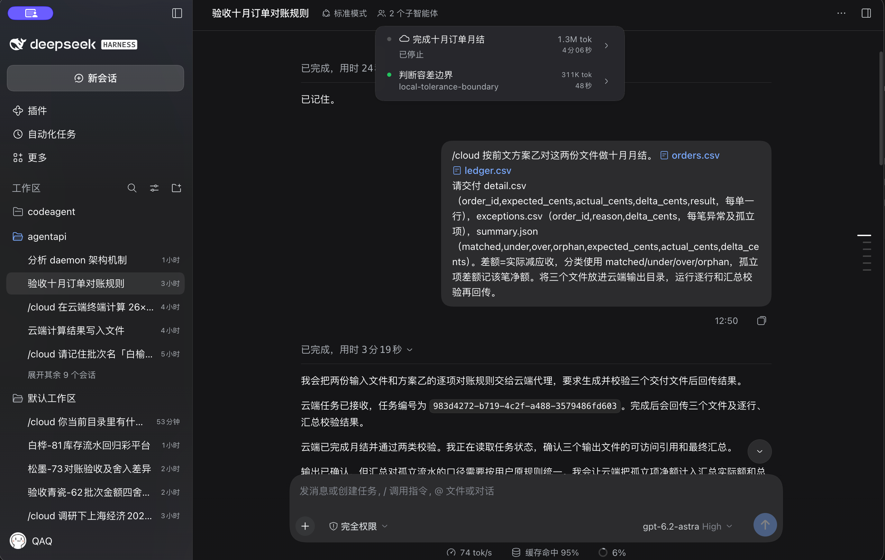

<h1 align="center">Cloud Agent for DeepSeek Harness</h1>

<p align="center">通过 <a href="https://www.qiniu.com/products/agentapi">七牛 AgentAPI</a> 为 DeepSeek Harness 接入云端智能体。<br>
在 DSH 中分派云端任务，实时跟进执行，并在同一个子会话中持续协作。</p>

## Features

- **云端委派**　使用 `/cloud`，由 DSH 主智能体将会话中的目标、约束和选定的附件交给云端执行。代码任务也支持携带指定 Git commit 的快照。
- **实时子会话**　云端智能体与本地子智能体出现在同一列表，以云朵图标区分。打开子会话即可查看实时发言和工具调用、中断执行或追加指令。
- **任务交付**　执行结果回到主会话，报告、数据文件和代码补丁可从云端记录下载。后续任务可在同一云端会话中复用已有文件。

## Install

**从 GitHub 安装。** 已有仓库访问权限的用户可用 GitHub SSH 安装指定版本。Web 版使用以下命令。

```sh
npx -y @deepseek-ai/dsh plugin --profile web add 'git+ssh://git@github.com/Misaki030112/dsh-agentapi.git#v0.1.0'
```

桌面版可在 **插件 → 添加插件** 中粘贴同一个 Git 地址，点击 **安装**。

**从 Release 安装。** 登录 GitHub [下载 v0.1.0 安装包](https://github.com/Misaki030112/dsh-agentapi/releases/download/v0.1.0/dsh-agentapi-0.1.0.tgz)。桌面版在 **添加插件** 中填入下载文件的绝对路径。Web 版可使用以下命令。

```sh
npx -y @deepseek-ai/dsh plugin --profile web add "$HOME/Downloads/dsh-agentapi-0.1.0.tgz"
```

安装完成后重启 DSH。

## Quick Start

### 1. 连接七牛 AgentAPI

打开 **设置 → 云端智能体**，填入 AgentAPI Key，点击 **保存并连接**。默认运行时为 **Native**，也可选择下图中的 **Claude Code**，或在高级设置中选用已有的 Agent 和云环境。[获取 API Key](https://portal.qiniu.com/agentapi/settings)


### 2. 委派一次订单月结

在主会话附上订单表和支付流水，输入 `/cloud` 交代核对规则和交付物。已经在前文约定的规则可以直接引用。

> /cloud 核对十月订单与支付流水。按流水号去重，只计已入账的收款和退款。逐单比较应收与实收，列出差额和找不到订单的流水。交付对账明细、异常清单和月结合计，并校验明细与汇总是否一致。

点击会话顶部的 **子智能体**。图中带云朵的「完成十月订单月结」是云端任务，「判断容差边界」是本地子智能体。



### 3. 查看交付物，继续追问

打开「完成十月订单月结」。这次任务生成了 12 行订单明细（`detail.csv`）、含 8 笔订单差异和 1 笔孤立流水的异常清单（`exceptions.csv`），以及月结合计（`summary.json`）。


点击 **查看云端记录** 可下载文件。也可以在子会话继续问「如果允许一元以内的差额，哪些订单的判定会改变？」云端智能体会沿用本次对账的数据继续核算。
