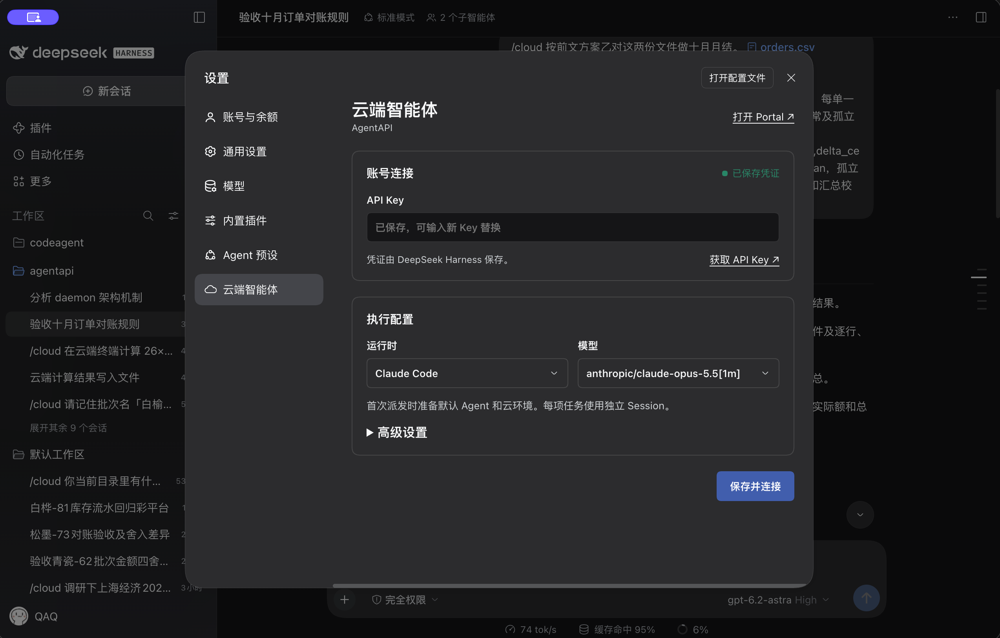
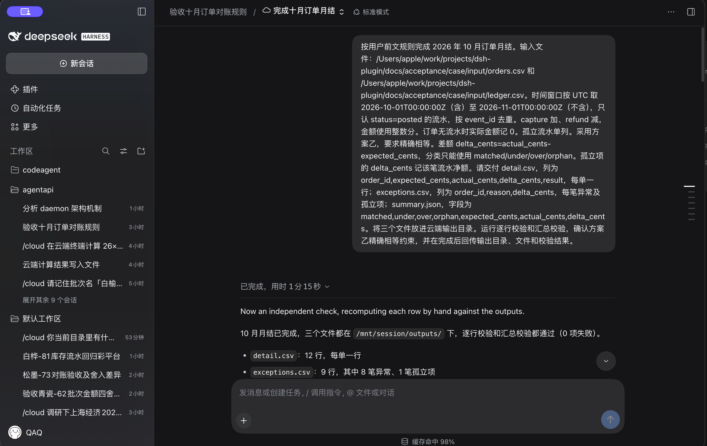

<h1 align="center">DSH × AgentAPI</h1>

<strong>七牛 AgentAPI 的 DeepSeek Harness 桌面插件</strong>

七牛 AgentAPI 为开发者提供智能体托管服务。你可以为智能体配置模型、工具和执行环境，由平台运行多步骤任务。通过这个插件，DSH 可以直接调用你在 AgentAPI 上配置的智能体，让它们作为云端子智能体参与当前项目。[了解七牛 AgentAPI](https://www.qiniu.com/products/agentapi)

## Install

在 DeepSeek Harness 桌面版打开 **插件 → 添加插件**，任选一种安装来源。

| 安装来源 | 在「添加插件」中填写 |
| --- | --- |
| Release 安装包 | 登录 GitHub [下载 v0.1.0 安装包](https://github.com/Misaki030112/dsh-agentapi/releases/download/v0.1.0/dsh-agentapi-0.1.0.tgz)，填入下载的 `.tgz` 文件的绝对路径 |
| GitHub 仓库 | 已配置仓库 SSH 访问权限时，直接粘贴 `git+ssh://git@github.com/Misaki030112/dsh-agentapi.git#v0.1.0` |

点击 **安装**，完成后重启 DSH。

## Quick Start

打开 **设置 → 云端智能体**，填入七牛 AgentAPI Key，点击 **保存并连接**。首次使用可保留默认的 **Native** 运行时，插件会在首次委派时准备 Agent 和云环境。已有 Agent 或云环境时，可在 **高级设置** 中选择。[获取 AgentAPI Key](https://portal.qiniu.com/agentapi/settings)

## 在 DSH 中使用 AgentAPI

### 主会话 · 委派与调度

在输入框键入 `/` 并选择 **云端智能体**，或直接用 `/cloud` 描述任务。DSH 主智能体会结合前文和你选中的附件组织委派，由 AgentAPI 创建独立的云端会话执行。任务完成后，结果回到主会话。

点击顶部的 **子智能体** 即可查看本次会话的成员。带云朵图标的条目运行在 AgentAPI 上。列表显示状态、Token 用量和耗时，点击条目即可进入对应会话。

### 云端子会话 · 执行与协作

这里展示主智能体交给云端的任务，以及云端智能体实时发出的消息、工具调用和执行结果。运行中可以直接中断，后续可在底部输入框补充要求，继续使用这个 AgentAPI 会话里的上下文和文件。

需要取回文件时，点击 **查看云端记录**，即可在七牛 AgentAPI 控制台下载本次会话的交付物。
