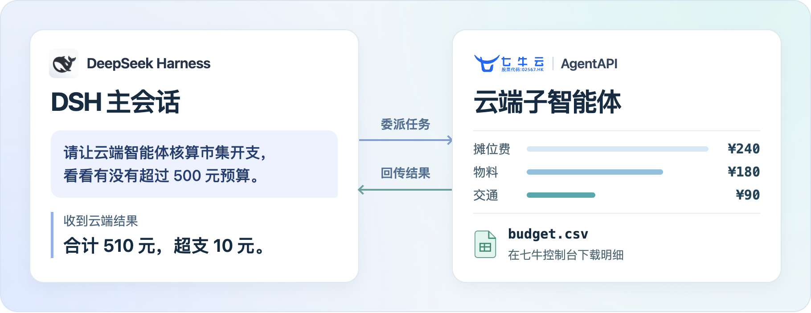
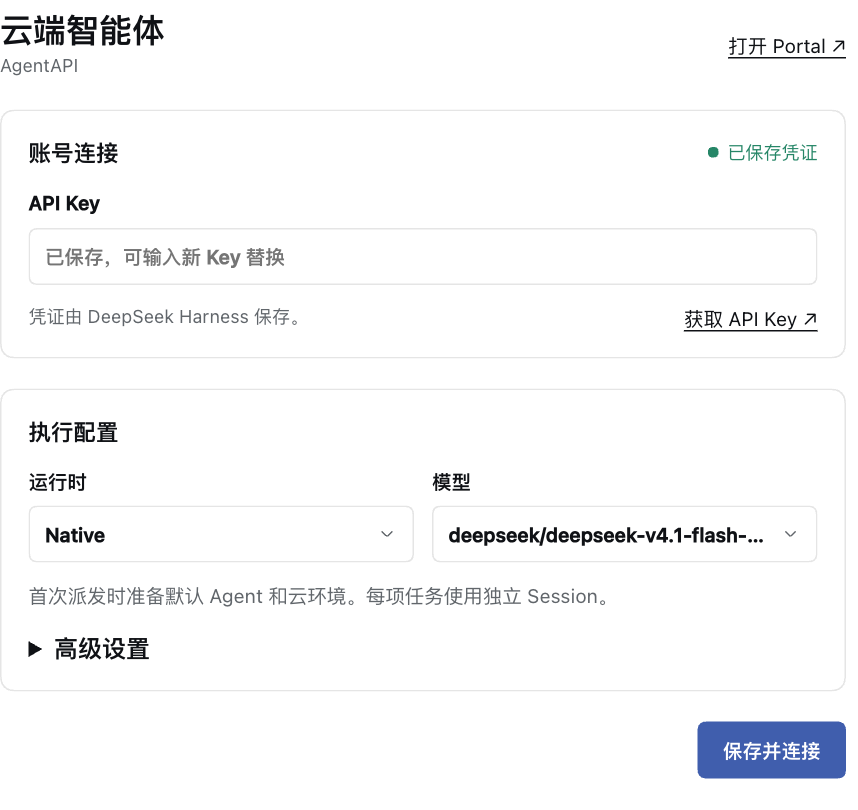
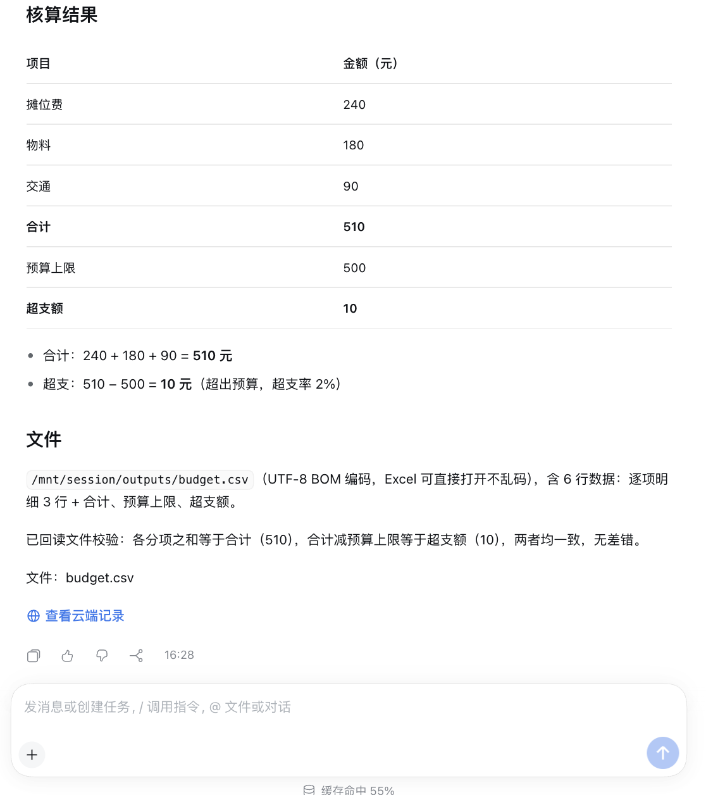

# AgentAPI for DeepSeek Harness

在 DeepSeek Harness（DSH）里使用七牛云端智能体。你在主会话交代任务，主智能体把前文里的目标和约束整理好，交给云端执行。打开子会话就能看它工作、接着追问，完成后主智能体会收到结果。

[安装插件](#安装插件) · [跑通第一个任务](#试一次云端委派) · [七牛 AgentAPI](https://www.qiniu.com/products/agentapi)

<picture>
  <source media="(max-width: 600px)" srcset="assets/readme/delegation-mobile.png">
  
</picture>

- **跟进执行。** 在 DSH 标题栏打开带云朵图标的子智能体，实时看它的发言，展开它刚用过的工具。
- **在原会话改要求。** 直接追问「把交通费改成 70 元，再算一次」。云端会话保留之前的文件，也支持随时中断本轮工作。
- **拿回交付物。** 核对表格可以要一份 CSV，审阅代码可以要一份补丁。从子会话的「查看云端记录」进入七牛控制台下载。

## 安装插件

准备好 DeepSeek Harness 桌面版和一枚七牛 AgentAPI Key。本指南使用 DSH `0.2.2-rc.5`。[DeepSeek Harness](https://github.com/deepseek-ai/deepseek-harness) · [七牛 AgentAPI 控制台](https://portal.qiniu.com/agentapi)

1. 下载并解压插件，把解压出的 `dsh-agentapi-main` 文件夹放到打算保留的位置。[下载插件 ZIP](https://github.com/Misaki030112/dsh-agentapi/archive/refs/heads/main.zip)
2. 在 DSH 左侧打开 **插件 → 添加插件**。粘贴该文件夹在你电脑上的完整路径，点击 **安装**。
3. 安装完成后重启 DSH，设置中就会出现 **云端智能体**。

## 连接七牛 AgentAPI

打开 **设置 → 云端智能体**，粘贴 AgentAPI Key，点击 **保存并连接**。页面提示 **已连接 AgentAPI，设置已保存。** 就可以开始。还没有 Key 时，点设置页的 **获取 API Key**。第一次可以保留默认的 **Native** 运行时。已有七牛 Agent 或云环境，也可以在 **高级设置** 中选择。

## 试一次云端委派

在 DSH 主会话发出下面这句话。这项任务不需要附件，跑完就能拿到一份 CSV。

> 请交给云端智能体核算周末市集预算。摊位费 240 元、物料 180 元、交通 90 元，预算上限 500 元。告诉我超支多少，把明细保存为 budget.csv。

也可以在输入框键入 `/`，选择 ☁️ **云端智能体**，再写下任务。派发后，打开标题栏的 **子智能体** 列表，点进这次的预算任务。

这次运行的结果是 **合计 510 元，超支 10 元**。展开子会话可以看到逐项核算。点 **查看云端记录** 可以下载 `budget.csv`。想试试续聊，可以直接在下方问「如果交通费降到 70 元，还剩多少预算？请更新这份 CSV。」

要换成自己的材料，在主会话用文件选择器添加附件，告诉智能体要处理哪份文件、交付什么。代码任务也可以指定 Git commit，把对应版本的快照交给云端，取回可审阅的补丁。[七牛 AgentAPI 文档](https://developer.qiniu.com/agentapi)
